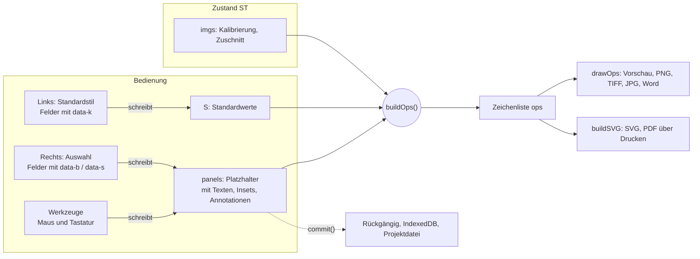

# Architektur des Bildtafel-Designers

Für alle, die am Code weiterarbeiten. Was das Programm kann, steht in der [README](README.md); die Bedienung erklärt die Kurzanleitung in der App (Knopf „?“).

## Dateien

| Datei | Inhalt |
|---|---|
| `ImageDesigner.html` | die ganze App: HTML, CSS und ein Skript, ohne Build-Schritt und ohne externe Bibliotheken |
| `index.html` | leitet auf `ImageDesigner.html` weiter (für die Installation als App) |
| `sw.js` | Service Worker: hält die App offline verfügbar. **Bei jeder Änderung an den Dateien `VERSION` erhöhen.** |
| `manifest.webmanifest`, `icons/` | Installation als App, „Öffnen mit“ für Bilder und Projektdateien |

Das Skript ist in Abschnitte gegliedert (`/* ---------- Name ---------- */`); ihre Reihenfolge steht als Inhaltsverzeichnis am Anfang des Skripts.

## Das Prinzip in einem Bild



Die App ist im Kern eine **reine Funktion vom Zustand zur Zeichenliste**. Jede Änderung schreibt in den Zustand und ruft `render()` auf; die Vorschau wird jedes Mal komplett neu gezeichnet. Es gibt keine Objekte, die sich selbst zeichnen, und keinen Zustand im DOM.

## Zustand

```text
ST = {
  S:      { figW, gap, lblSize, sbColor, anColor, … }   // Standardwerte, Vorgaben in DEF
  L:      { mode: 'smart' | 'cells' | 'free', cols, rows, cells }   // cells: Vorlage oder Raster
  panels: [ { id, x, y, w, h,                          // Platzhalter in Figurpixeln
              img, zoom, cx, cy, fit, adj,              // Bild darin
              label, sb: { on, val, unit },             // Inhalt
              st: { … }, fix: { … },                    // eigener Stil, fixierter Stand (siehe unten)
              texts:   [ { id, text, corner, align, st, fix } ],
              insets:  [ { id, src: 'region' | 'image', region | img, corner, st, fix } ],
              annots:  [ { id, type, p: [[x, y], …], text?, st, fix } ] } ],   // p in Bildpixeln
  imgs:   { [id]: { name, mpp, crop, bar, hideBar, … } }
}
IMG = Map(id → { w, h, full, prev, blob, meta })   // die Pixel, nicht in ST
```

- `ST` ist reines JSON. Rückgängig, Speichern im Browser und die Projektdatei kopieren es vollständig; die Pixel liegen getrennt in `IMG`.
- Daneben gibt es nur Zustand der Bedienung: Auswahl (`sel`, `msel`, `selItem`), Werkzeug (`mode`, `atool`), Ansicht (`zoom`, `VT`) und den laufenden Ziehvorgang (`drag`).
- **Koordinaten:** Die Abbildung rechnet in CSS-Pixeln zu 96 dpi (`PT` = pt → px, `MM` = mm → px). Annotationen und Inset-Ausschnitte stehen in **Bildpixeln**, damit sie beim Verschieben und Zoomen des Bildes mitwandern; `geom(p)` liefert `toFig` und `toImg` für die Umrechnung.

## Stilsystem: Standard, eigene Werte, fixiert

Jedes Element folgt dem Standard `S`, bis es einen Wert selbst setzt. Ändert man den Standard, ändern sich alle Elemente mit, die keinen eigenen Wert haben. Diese Eigenschaft ist der Kern des Programms und sein Vorteil gegenüber Inkscape.

```js
sv(k, el, p)   // eigener Wert el.st[k] → fixierter Stand el.fix[k] → fixierter Platzhalter p.fix[k] → Standard S[k]
```

- Beim Zeichnen werden Stilwerte **immer über `sv()` bzw. `svOf(el, p)` gelesen, nie direkt aus `S`**, sonst wirkt ein eigener Wert nicht.
- **Fixieren** kopiert die aktuellen Standardwerte nach `el.fix`. Ein fixierter Platzhalter friert auch seine Texte, Insets und Annotationen ein, deshalb steht `p.fix` in der Kette.
- Neue Elemente werden **ohne** Stilwerte angelegt (`st: {}`), damit sie dem Standard folgen.

### Eine Tabelle für beide Seitenleisten

`F` beschreibt das Eingabefeld je Schlüssel, `KIND` die Zeilen je Elementart. Daraus entstehen:

- links die Standardfelder (`buildStdUI()`, Attribut `data-k`, angebunden wie alle globalen Einstellungen) mit dem Hinweis, wie viele Elemente abweichen (`updStdMarks()`);
- rechts der Block „Aussehen“ des gewählten Elements (`styBlock()`, Attribut `data-s`) mit Markierung je Wert und den Knöpfen ↺, ⇧ und 📌.

| Art | Element | Präfix der Schlüssel |
|---|---|---|
| `lbl` | Label eines Platzhalters | `lbl…` |
| `sb` | Maßstabsbalken eines Platzhalters | `sb…` |
| `frame` | Rahmen und Fläche eines Platzhalters | `frame…`, `panelBg…` |
| `txt` | Textfeld | `txt…` |
| `an` | Annotation | `an…` |
| `ins` | Inset | `ins…` |

**Neue Stileigenschaft hinzufügen:**

1. Vorgabe in `DEF` mit dem Präfix der Art, z. B. `anOpacity: 1`.
2. Eingabefeld in `F`, z. B. `anOpacity: ['num', 0.1, 0, 1]` (Typen: `num`, `color`, `chk`, `sel`).
3. Zeile in `KIND.an.rows`; optional mit einer Bedingung als drittem Eintrag (z. B. nur für Text-Annotationen).
4. Beim Zeichnen mit `v('anOpacity')` bzw. `sv('anOpacity', el, p)` lesen.

Damit funktionieren automatisch: das Feld links und rechts, die Abweichungsanzeige, Fixieren, Rückgängig und das Speichern in Stilen (`sanitizeStyle` prüft gegen `DEF` und die Auswahllisten der linken Felder).

## Zeichenliste

`buildOps()` ergibt `{ ops, W, H, hits }`. `ops` ist eine Liste einfacher Grundelemente in Figurpixeln:

| `k` | Bedeutung |
|---|---|
| `rect` | Rechteck mit Füllung (`fill`, Deckkraft `fa`) und/oder Rand (`stroke`, `sw`, Strichmuster) |
| `img` | Ausschnitt eines Bildes (`sx, sy, sw, sh` in Bildpixeln) in ein Zielrechteck |
| `clip` | Gruppe mit rechteckigem Zuschnitt (jeder Platzhalter) |
| `tr` | verschobene Gruppe (Seiten-Export) |
| `path`, `ell`, `text` | SVG-Pfad, Ellipse, Textzeile |

- **Ecken:** Labels, Maßstabsbalken, Insets und Textfelder liefern je ein Element `{ w, h, draw(x, y) }`. `buildOps` stapelt sie pro Ecke, jedes mit seinem eigenen Abstand zum Rand.
- `hits` enthält die Lage von Platzhaltern und Insets für die Trefferprüfung mit der Maus.
- **Ausgabe:** `drawOps()` zeichnet auf ein Canvas (Vorschau, PNG, TIFF, JPG, „Für Word kopieren“), `buildSVG()` schreibt SVG (auch für PDF über Drucken). Neue Grundelemente müssen in **beiden** ergänzt werden.
- In SVG werden Bildausschnitte als `clipPath` mit Transformationsmatrix geschrieben, nicht als verschachteltes `<svg viewBox>`, weil Inkscape dessen Beschnitt ignoriert.
- Eingefügte SVG-Dateien sind in der Vorschau und für PNG/TIFF gerastert (`IMG.full`), das Original bleibt in `IMG.blob`. `buildSVG()` setzt es mit `inlineSvg()` als `<g>` ein, denn `<image>` mit SVG-Daten behandelt Inkscape als Bild ohne bearbeitbare Pfade. IDs bekommen je Vorkommen ein Präfix, eingebettetes CSS wird auf die Gruppe begrenzt.

## Bedienung

- **Werkzeuge** (`mode`): `layout`, `image`, `scale`, `annot` (mit `atool`), `inset`.
- **Ziehen:** `pointerdown` legt `drag = { t, … }` an, `pointermove` ändert den Zustand je nach `drag.t`, `pointerup` schließt ab und ruft `commit()` auf.

| `drag.t` | Vorgang |
|---|---|
| `move`, `resize`, `pcreate` | Platzhalter verschieben, skalieren, frei aufziehen (mit Einrasten) |
| `pan`, `iscale` | Bild im Platzhalter verschieben, zoomen |
| `inset`, `rcreate`, `rmove` | Inset in eine Ecke ziehen, Ausschnitt aufziehen, verschieben |
| `acreate`, `amove`, `anode` | Annotation zeichnen, verschieben, an einem Griff umformen |
| `measure` | Maßstab nachzeichnen |
| `vpan` | Ansicht verschieben |

- **Rechte Seitenleiste:** `buildProps()` erzeugt sie bei jeder Auswahl neu. Felder mit `data-b="scope:pfad"` schreiben direkt in das Element (`scope`: `p`, `img`, `tx0`, `in0`, `an`), Knöpfe mit `data-act` gehen an `propAction()`.

## Speichern, Rückgängig, ältere Dateien

- `commit()` legt einen JSON-Schnappschuss von `ST` in den Verlauf (Rückgängig/Wiederholen), speichert verzögert in IndexedDB (`saveSoon()`) und markiert das Projekt als geändert. Für Eingaben während des Tippens gibt es `commitSoon()`.
- Die Projektdatei (`.bildtafel.json`) ist `{ app: 'ImageDesigner', version: 1, state: ST, images }` mit allen verwendeten Bildern als Daten-URL.
- Beim Laden bringt `sanitize()` ältere Stände auf den aktuellen Aufbau: `migrateSt()` verschiebt eigene Werte nach `.st` und verwirft Standardwerte, die frühere Versionen beim Anlegen kopiert hatten. `padCompat()` übernimmt den früheren gemeinsamen Randabstand für Labels, Maßstab, Textfelder und Insets. Solche Übergänge immer dort ergänzen, damit alte Projekte unverändert aussehen.

## Konventionen

- Oberfläche, Kommentare und Commit-Texte auf Deutsch.
- Keine externen Bibliotheken; die App muss als einzelne Datei per Doppelklick laufen.
- Kommentare erklären das Warum, nicht das Was.
- Getestet wird von Hand im Browser (Edge/Chrome). Für den SVG-Export lohnt der Gegencheck in Inkscape.
