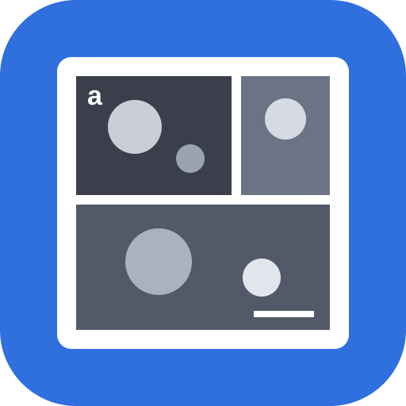

# ImageDesigner – Bildtafel-Designer

Layout wählen → Bilder hineinziehen → Maßstab, Labels und Beschriftung → als PNG, TIFF, SVG, PDF oder für Word exportieren.

Eine einzelne HTML-Datei ohne Build-Schritt und ohne externe Bibliotheken. Alles läuft lokal im Browser; die Bilder verlassen den Rechner nicht. Das Gegenstück für Diagramme ist der Diagramm-Designer (PlotTransformer).

## Funktionen

- **Layout:** Vorlagen (einzeln, 2/3/4 nebeneinander oder untereinander, 2×2, 3×2, 1 groß + 2/3 klein …), freies Raster und **Smart**: ordnet die Bilder zeilenweise so an, dass sie nach ihren Seitenverhältnissen ohne Beschnitt die Breite füllen. Höhe automatisch oder fest, Abstand und Außenrand in mm.
- **Platzhalter:** in der Vorschau verschieben und skalieren (mit Einrasten an Kanten und Abständen; Alt = ohne Einrasten, Shift = Seitenverhältnis halten) oder per Zahlenfeld. Ist der Platzhalter größer als das sichtbare Bild, rastet die gezogene Seite an der Bildkante ein (grüne Linie), bevor das Bild beim Weiterziehen schrumpft. Ergänzen, entfernen, duplizieren, Reihenfolge per Ziehen ändern.
- **Freie Platzierung** (Kachel „Frei“): Größe der Abbildung selbst festlegen, auf leerer Fläche Platzhalter aufziehen (Shift = quadratisch) oder Bilder dorthin ziehen – sie bekommen einen passenden Platzhalter, Diagramme mit Druckgröße gleich ihre Originalgröße. Größenänderungen verschieben nichts (optional mitskalieren). Zum Schluss „Abbildung an Platzhalter anpassen“.
- **Arbeitsfläche:** Platzhalter bleiben auch außerhalb der Abbildung sichtbar und greifbar (blass = wird nicht exportiert, die Statuszeile warnt). „Abbildung an Platzhalter anpassen“ setzt Breite und Höhe passend zu allen Platzhaltern.
- **Seite als Größenvergleich:** A2–A6 hochkant/quer, Folie 16:9 oder 4:3, individuell; mit Seitenrand und Satzspiegel (gestrichelt), Abbildung am Rand oder mittig. Seite, Satzspiegel und Abbildung sind in der Vorschau mit ihren Maßen beschriftet. „100 %“ zeigt die Originalgröße. Export wahlweise nur die Abbildung oder die ganze Seite.
- **Ausrichten & Verteilen:** Mehrfachauswahl mit Shift/Strg + Klick, gemeinsam verschieben; links/Mitte/rechts, oben/Mitte/unten, gleichmäßig verteilen, mit eingestelltem Abstand aneinanderreihen, gleiche Breite/Höhe/Größe.
- **Zeilen- und Spaltenüberschriften** (z. B. „vorher/nachher“, „Probe A/B“), Platz wird automatisch freigehalten; Zeilenüberschriften senkrecht oder waagerecht.
- **Diagramme einfügen:** SVG und PNG aus dem Diagramm-Designer per Datei, Drag & Drop oder Strg+V. Diagramme werden ganz gezeigt (Einpassen), mit weißem Grund und schwarzem Label; „Originalgröße“ setzt den Platzhalter auf die Größe des Diagramms, damit Schriftgrößen erhalten bleiben. Im SVG-/PDF-Export bleibt ein SVG-Diagramm Vektorgrafik. Transparente PNGs zeigen den Abbildungshintergrund.
- **Gleiche Vergrößerung:** alle kalibrierten Bilder im selben Maßstab (gleiche µm je cm), gleiche Maßstabsbalken, gemeinsamer Zoom.
- **Standardstil und eigene Werte:** Links steht der Standardstil (gilt für alle), rechts die aktuelle Auswahl. Jede Stileinstellung gibt es an beiden Stellen. Ein Element folgt dem Standard – ändert man ihn, ändern sich alle mit –, bis man rechts einen eigenen Wert setzt (orange markiert; ↺ zurück zum Standard, ⇧ als Standard übernehmen). **📌 Fixieren** nimmt ein Element (oder einen ganzen Platzhalter samt Texten, Insets und Annotationen) von späteren Änderungen am Standard aus. Links zeigt jede Zeile, wie viele Elemente dort abweichen.
- **Vorlagen & Stile:** eingebaute Vorlagen (helle/dunkle Bilder, Kästen, Zeitschrift 1-/2-spaltig, Präsentation), eigene Stile im Browser, ein gemeinsamer Stil-Ordner (Edge/Chrome, z. B. auf dem Netzlaufwerk) sowie Export/Import als JSON.
- **Bild und Maske:** Werkzeug „Platzhalter“ skaliert den Platzhalter samt Bild. Werkzeug „Bild“ verschiebt/skaliert nur das Bild (Eckgriffe oder Mausrad); der Platzhalter bleibt starr und schneidet alles außerhalb ab. „Füllen“, „Einpassen“, Drehen um 90°.
- **Dateien:** PNG, JPG, TIFF (eigener Decoder: unkomprimiert, LZW, Deflate, PackBits; 1/8/16/32 bit, Graustufen, RGB, Palette). Mehrere Dateien auf einmal ablegen füllt leere Platzhalter und ergänzt fehlende.
- **TIFF-Metadaten:** Pixelgröße aus FEI/Thermo-, Zeiss- und ImageJ-Dateien; Messdaten (Hochspannung, Detektor, WD …) anzeigen und als Textfeld einfügen; **Infobalken** (REM-Datenleiste) erkennen und ausblenden, dazu freier Zuschnitt.
- **Helligkeit, Kontrast, Gamma, Invertieren** je Bild, Auto-Kontrast, „auf alle übertragen“.
- **Maßstabsbalken:** Kalibrieren durch Nachzeichnen eines vorhandenen Maßstabs (oder Pixelgröße eingeben, auf alle Bilder übertragen). Länge automatisch (1-2-5-Werte) oder fest, passt sich beim Skalieren des Bildes an. Farbe, Dicke, Schrift, Beschriftung oben/unten, Endstriche, Kasten (Füllung, Deckkraft, Rand), Ecke – auch je Bild; optional gleiche Länge in allen Bildern.
- **Bildlabels** a, b, c / A, B, C / (a) / a) / i, ii … mit Größe, Farbe, Fett/Kursiv, Kasten (Füllung, Deckkraft, Rand) und Ecke; alles je Platzhalter überschreibbar.
- **Textfelder** in sechs Positionen (Ecken und Mitte oben/unten), mehrzeilig, links-/rechtsbündig oder zentriert, mit Kasten (Füllung, Deckkraft, Rand). Elemente in derselben Ecke werden automatisch gestapelt; Labels, Maßstab, Insets und Textfelder haben je einen eigenen Abstand zum Rand.
- **Insets:** eigenes Bild oder vergrößerter Ausschnitt (im Bild aufziehen) mit Markierung und Verbindungslinien; Ecke per Ziehen wählen.
- **Annotationen:** Pfeil, Linie, Rechteck, Ellipse, Text – mit Linienstil (durchgezogen, gestrichelt, gepunktet, Strich-Punkt) und runden oder eckigen Enden, Text mit Kasten (Füllung, Deckkraft, Rand); sie hängen am Bild und wandern beim Verschieben/Zoomen mit. Nachträglich an Griffen umformen: Pfeil und Linie an den Enden, Rechteck und Ellipse an Ecken und Kanten.
- **Rahmen** um die Platzhalter (Farbe, Breite; je Platzhalter einstellbar), **Bildunterschrift** mit **fett**/*kursiv* und Blocksatz.
- **Export:** PNG, TIFF (LZW) und JPG mit dpi-Angabe (150–1200 dpi), SVG (Bilder eingebettet, Text als Vektor), PDF über Drucken, „Für Word kopieren“ in Originalgröße. Hinweis bei zu geringer Bildauflösung.
- **Projekte:** „Öffnen“, „Speichern“ und „Speichern unter…“ in der Kopfzeile. Die Projektdatei `.bildtafel.json` enthält alle Bilder und lässt sich weitergeben. In Edge/Chrome speichert Strg+S nach dem ersten „Speichern unter…“ direkt in dieselbe Datei (auch nach einem Neustart, nach einmaliger Bestätigung); andere Browser laden die Datei herunter. Öffnen auch per Drag & Drop auf die Fläche oder in der installierten App mit „Öffnen mit“. Ein ● vor dem Namen zeigt ungespeicherte Änderungen.
- **Rückgängig/Wiederholen** (Strg+Z / Strg+Y), automatisches Speichern im Browser (IndexedDB, inkl. Bilder) – beim nächsten Öffnen geht es dort weiter, wo man aufgehört hat. **„＋ Neu“** in der Kopfzeile beginnt mit einer leeren Fläche im Ausgangszustand (wahlweise mit dem bisherigen Stil; rückgängig machbar).

## Tastenkürzel

| Taste | Wirkung |
|---|---|
| ? | Kurzanleitung (auch Knopf „?“ in der Kopfzeile) |
| V / B / M / A / I | Werkzeug Platzhalter / Bild / Maßstab / Annotation / Inset |
| Doppelklick | leerer Platzhalter: Bild öffnen · sonst zwischen Platzhalter und Bild wechseln |
| Pfeiltasten (Shift = ×10) | Platzhalter, Bild oder Annotation verschieben |
| Strg+A | alle Platzhalter auswählen (dann gemeinsam ziehen oder mit Pfeiltasten verschieben) |
| Shift/Strg + Klick | Platzhalter zur Auswahl hinzufügen oder entfernen |
| Strg+Z / Strg+Y | Rückgängig / Wiederholen |
| Strg+S / Strg+Umschalt+S / Strg+O | Projekt speichern / speichern unter / öffnen |
| Entf | gewählte Annotation, Inset oder Platzhalter löschen |
| Strg + Mausrad | Vorschau auf den Mauszeiger zoomen (Zoom-Regler und „100 %“: auf die Mitte) |
| Mausrad (Shift = waagerecht) | Vorschau verschieben; im Werkzeug „Bild“ über einem Bild: Bild zoomen |
| mittlere Maustaste / Leertaste + Ziehen | Vorschau verschieben |

## Nutzung

`ImageDesigner.html` per Doppelklick in Edge oder Chrome öffnen. Für die Installation als App (inkl. „Öffnen mit“ für TIFF/PNG/JPG) muss die Seite über `https://` oder `http://localhost` geladen werden, wie beim Diagramm-Designer.

Wie das Programm aufgebaut ist (Zustand, Zeichenliste, Stilsystem, Bedienung, Speichern), steht in [ARCHITEKTUR.md](ARCHITEKTUR.md).
